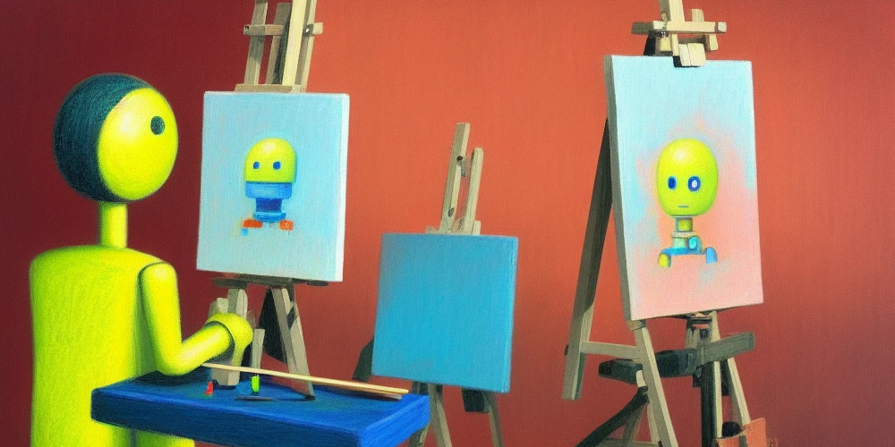

# ArtBot for Stable Diffusion



See it in action: [https://tinybots.net/artbot](https://tinybots.net/artbot)

## Table of Contents

- [Intro](#intro)
- [Setup](#setup)
  - [Requirements](#requirements)
  - [Installing](#installing)
  - [Environmental variables](#environmental-variables)
- [Usage](#usage)
  - [Development](#development)
  - [Production](#production)
- [Troubleshooting](#troubleshooting)
  - [Windows](#windows)
  - [Other issues](#other-issues)
- [Contributions](#contributions)
- [License](#license)

## Intro

ArtBot is an unofficial front-end web client designed for interacting with the [AI Horde](https://aihorde.net/) (formerly Stable Horde) distributed cluster -- a group of GPUs running Stable Diffusion image generation models whose processing time has been kindly donated by an enthusiastic community of volunteers.

ArtBot is built using [Next.js 16](https://nextjs.org/) and [Typescript](https://www.typescriptlang.org/). It with was created as a side project in order to experiment with various client-side technologies, such as IndexedDB and LocalStorage APIs. These APIs allow you to securely and privately store the AI generated images you've created with the cluster within your own browser.

The UI components are custom built using a combination of [Styled Components](https://styled-components.com/) and [Tailwind CSS](https://tailwindcss.com/), with more recent efforts strictly focused on using Tailwind CSS. The long term goal is to completely remove Styled Components from the code base.

ArtBot makes use of icons from [Tabler](https://tabler-icons.io/).

## Setup

### Requirements

- Node.js **26.13.1 LTS** (Lithium), pinned in `.nvmrc`, Docker, CI and the
  production PM2 configuration. The supported engine range is `^26.13.1`.
- npm **11.20.0 or later**; Node 26.13.1 bundles npm 11.20.0. Use `npm ci` with
  the committed version-3 lockfile.

This is the [current LTS release](https://nodejs.org/en/download) as of
2026-11-11. Keep the pinned development, CI, container and PM2 versions aligned
when updating the runtime.

Most of these steps should be applicable to Linux / MacOS / Windows environments.

Installing various versions of Node.js on your machine can be tricky. I am a big fan of [nvm](https://github.com/nvm-sh/nvm), which allows you to run multiple isolated versions of Node.js on your machine with ease.

Using `nvm`, you can install Node like this:

```bash
> nvm install
> nvm use
```

### Installing

Once you have your Node.js environment setup, you can clone this repository and install the required packages. Depending on the specs of your machine and speed of your internet connection, installing all packages may take a minute or two.

```bash
> git clone https://github.com/daveschumaker/artbot-for-stable-diffusion
> cd artbot-for-stable-diffusion
> npm ci
```

### Environmental variables

A `.env` file in the root of the project is optional. The code base references a few environmental variables in various places. These are generally endpoints for messaging, telemetry services that I run, or local data storage related to model counts and image generation totals.

## Usage

### Development

Alright, you should now be able to run the ArtBot web app! To run in development mode (which uses NextJS's hot reloading feature -- where you can see updates live on the site as you make changes)

```bash
> npm run dev
```

Then, open your browser and visit `http://localhost:3000`, you should now be able to immediately make image requests to the Stable Horde. Head over to `http://localhost:3000/artbot/settings` and enter your Stable Horde API key for faster generation times.

### Production

If you want to run this in a production type of environment, you'll first need to kick off a build and then run as you normally would run a Node.JS app.

```bash
> npm run build
> npm run start
```

`npm run start` uses whichever Node is first on your `PATH`, and Next.js 16 won't start on Node 18.

On TinyBots, my web server for hosting ArtBot, I use [PM2](https://pm2.keymetrics.io/) in order to persist the application and automatically restart after crashes or reboots. [ecosystem.config.js](ecosystem.config.js) runs ArtBot with its own Node (`interpreter`), separate from the server's default Node used by other apps. That exact Node version must be installed on the server.

Start and stop it with:

```bash
> npm run pm2:start-prod
> npm run pm2:stop-prod
```

`pm2 restart` keeps an app's old interpreter and script. After changing either in `ecosystem.config.js`, stop and start the app, then run `pm2 save`.

## Troubleshooting

For production-state regression and upgrade testing, see
[Production-origin browser profiles](docs/browser-profiles.md).

### Windows

The npm scripts set environment variables inline (for example `NODE_ENV=production next start`), which Windows `cmd` doesn't support. Use WSL, or run the underlying command in a shell that does.

### Other issues

For other issues not mentioned here, feel free to [open a new issue on Github](https://github.com/daveschumaker/artbot-for-stable-diffusion/issues) or visit the [ArtBot feedback channel](https://discord.com/channels/781145214752129095/1107628882783391744) on the Stable Horde Discord server.

## Contributions

Contributions are very welcome! General guidelines are as follows:

1. [Fork this repository](https://github.com/daveschumaker/artbot-for-stable-diffusion/fork)
2. Cut a new feature branch. e.g., `> git checkout -b my-cool-new-feature`
3. Make any necessary changes.
4. [Open a new pull request](https://github.com/daveschumaker/artbot-for-stable-diffusion/pulls) based on your feature branch.

Let me know if you have any questions. I'm more than happy to help.

## License

See [LICENSE.md](LICENSE.md)
